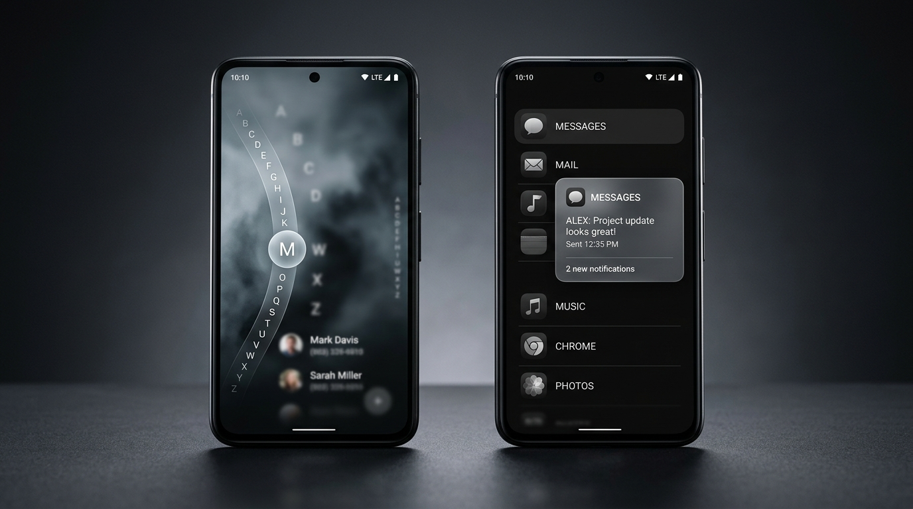

<div align="center">


# Glassbon

**Minimalist Frosted Liquid-Glass Android Launcher**  
*Curved dual-edge Gaussian alphabet waves, adaptive multi-zone wallpaper contrast, compact monochrome squircles, and zero idle battery overhead.*

[](LICENSE)
[](https://developer.android.com/jetpack/compose)
[](.github/workflows/android-release.yml)
[](SECURITY.md)

[Mockups](#-interface-mockups) · [Architecture](#-architecture--zero-battery-guarantee) · [Guided Tour](#-interactive-in-app-walkthrough) · [Build & Release](#-building--testing-locally) · [Contributing](CONTRIBUTING.md)

</div>

---

## Interface Mockups

<table>
  <tr>
    <td width="50%" align="center">
      
      <br />
      <sub><strong>Intentional Home Workspace</strong> — Unified Clock & Calendar pill, compact left-gutter squircles, adaptive ink, and bottom-right Quick Actions control.</sub>
    </td>
    <td width="50%" align="center">
      
      <br />
      <sub><strong>Dual-Edge Wave & Pop-Up Preview</strong> — Hidden left-edge curved Gaussian wave scrubbing and frosted Pop-Up App Preview card.</sub>
    </td>
  </tr>
</table>

---

## Core Experience

- **Aesthetic Frosted Liquid-Glass Home Screen**
  - Edge-to-edge grayscale misty alpine forest wallpaper (or any personal photo via Android's zero-permission **Photo Picker**) with off-thread `RGB_565` bitmap caching.
  - **Adaptive Multi-Zone Luminance Contrast**: Samples top, middle, and side-edge wallpaper luminance once off-thread (`12×12` grid) to adjust status bar icons, clock/date ink, right-edge contrast scrims, and favorite icon backing automatically.
  - **Unified Clock & Frosted Calendar Pill**: Styled in **Plus Jakarta Sans** or **Instrument Serif**; tap time to open Alarms/Clock or tap the frosted date pill to launch Calendar.
- **Dual-Edge Curved Alphabet Wave**
  - Scrub vertically along the visible **Right A–Z Rail** *or* touch/drag the **Hidden Left Edge** (`28.dp` outer gutter protects favorites from accidental taps).
  - At rest, the hidden left wave composes **zero** child nodes (`0%` idle GPU/CPU cost). Touching wakes a curved Gaussian arc wave and floating circular frosted bubble (`★` Favorites → `A–Z` → `#`).
  - Only alphabet edges open the App Library (and swiping down in the drawer returns smoothly to Home)—direct vertical swipes on Home remain calm and deliberate.
- **Compact Frosted Squircles & Pop-Up App Preview**
  - Defaults to `COMPACT` frosted monochrome squircles (`42.dp` Home / `32.dp` Drawer) with specular rim highlights and corner-sampled background suppression.
  - **Long-press any app** to launch the finite-spring **Frosted Pop-Up App Preview** card with an inline status pill (`Home #N`, `Hidden`, or `App`), reordering, hiding, App Info, and uninstall controls.
- **Smart Audio Media Capsule**
  - Automatically expands beneath Clock/Date using zero-permission `AudioManager` hardware media key events (`KEYCODE_MEDIA_PLAY_PAUSE` / `NEXT` / `PREVIOUS`) while audio plays, then collapses cleanly when idle.
- **Quick Actions, Lock Screen Settings & Zero Sensitive Permissions**
  - Tap or press-and-hold the bottom-right glass control for **Quick Actions**, **Search**, **App Library**, **Wallpaper Studio**, **Home Shortcuts**, **Preferences** (**Ultra-Smooth** vs. **Low Power**), **Screen Lock Settings**, and the **Guided Feature Tour**.
  - Zero `INTERNET`, `BIND_ACCESSIBILITY_SERVICE`, `BIND_DEVICE_ADMIN`, `BIND_NOTIFICATION_LISTENER_SERVICE`, `REQUEST_DELETE_PACKAGES`, SMS, or broad storage permissions.

---

## Architecture & Zero-Battery Guarantee

<div align="center">
  
</div>

| Subsystem | Zero-Overhead Technique | Battery & Performance Impact |
| :--- | :--- | :--- |
| **Wallpaper & Blur** | Static `RGB_565` downscaled bitmaps + one-time `RenderEffect` / downsampled drawer pre-blur | Zero per-frame shader overhead |
| **Luminance Contrast** | Single `12×12` pixel grid sample on `Dispatchers.IO` upon wallpaper change | Cached boolean flags; zero runtime polling |
| **Hidden Left Wave** | Transparent `30.dp` touch strip at rest; 28-letter Gaussian arc composes only during drag | `0%` idle CPU/GPU composition cost |
| **Animations** | Finite `< 220ms` springs & tweens evaluated strictly inside `graphicsLayer` / `offset` | Zero full-tree recompositions; respects **Reduced Motion** |
| **Clock & Media** | Event-driven `ACTION_TIME_TICK` & `AudioManager` media keys bound to `onStart`/`onStop` | Zero background loops, listeners, or timers |

---

## Interactive In-App Walkthrough

Glassbon includes a built-in **6-Step Interactive Feature Tour** (`WalkthroughOverlay`) featuring swipeable frosted glass cards and live spatial edge/corner anchor beacons:

1. **Pure Calm, Zero Battery Drain** — Static cached frosting & zero polling overview.
2. **Unified Clock & Calendar Pill** — Tap targets & adaptive wallpaper contrast.
3. **Dual-Edge Curved Wave** — Hidden left-edge & right-arc A–Z scrubbing.
4. **Compact Icons & Pop-Up Preview** — Outer gutter layout & long-press preview menu.
5. **Smart Audio Media Capsule** — Space-reclaiming zero-permission playback card.
6. **Quick Actions & Customization** — Bottom-right control for Quick Actions, Search, App Library, or System Screen Lock Settings.

Replay the tour anytime via **Quick Actions → Guided Feature Tour** or **Preferences → Guide → Interactive Feature Tour**.

---

## Building & Testing Locally

```bash
# Build Debug APK
gradle :app:assembleDebug

# Run all Unit & Robolectric UI Tests (no emulator needed)
gradle :app:testDebugUnitTest --no-daemon
```

---

## GitHub Push & Automated APK Releases

This repository includes `.github/workflows/android-release.yml`:
- **Push / Pull Request to `main`**: Runs `:app:testDebugUnitTest` and uploads `Glassbon-debug-apk` as a workflow artifact.
- **Version Tag (`v*`) or Manual Dispatch**: Automatically builds the APK and publishes a GitHub Release with the APK attached.

```bash
git tag v1.0.0
git push origin v1.0.0
```

*(Optional)* Add repository secrets `KEYSTORE_BASE64`, `STORE_PASSWORD`, and `KEY_PASSWORD` (alias `upload`) for signing with your release key; otherwise the workflow generates a clean release keystore and outputs an R8-minified, non-debuggable `Glassbon-*-release.apk`.

---

## Community, Rules & Licensing

- **Contributing Guidelines**: Read [CONTRIBUTING.md](CONTRIBUTING.md) and our [Pull Request Checklist](.github/PULL_REQUEST_TEMPLATE.md) before submitting code.
- **Code of Conduct**: Governed by the [Contributor Covenant v2.1](CODE_OF_CONDUCT.md).
- **Security & Privacy Policy**: Offline zero-network architecture and disclosure instructions in [SECURITY.md](SECURITY.md).
- **Release History**: Tracked in [CHANGELOG.md](CHANGELOG.md).
- **License**: Distributed under the **[MIT License](LICENSE)**.
