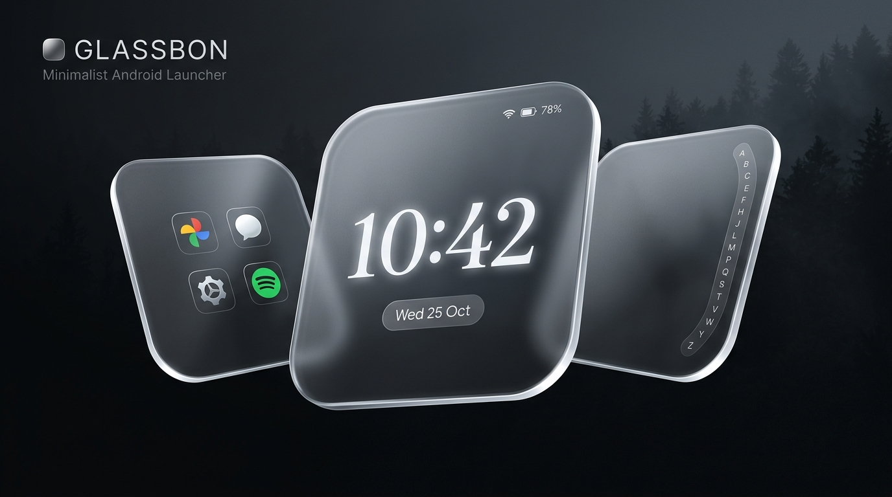
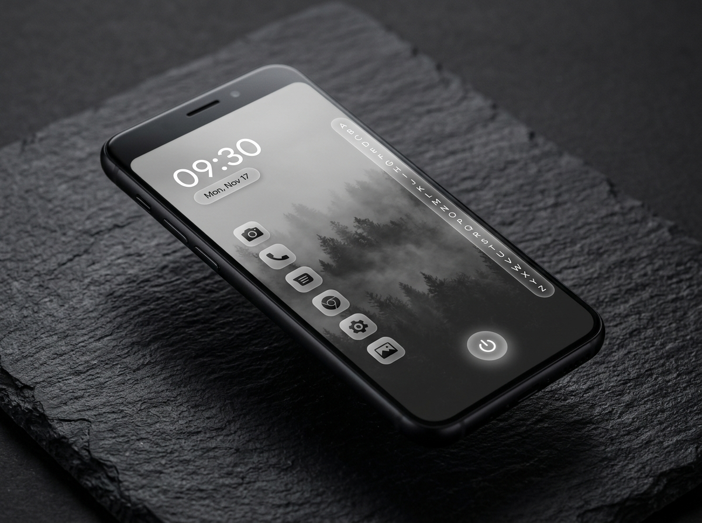
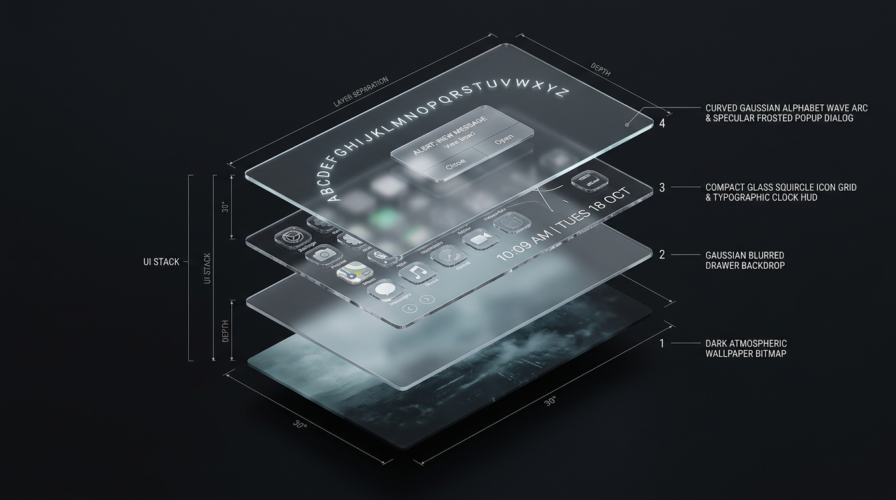

<div align="center">



# Glassbon

**Minimalist Frosted Liquid-Glass Android Launcher**  
*Curved dual-edge Gaussian alphabet waves, adaptive multi-zone wallpaper contrast, compact monochrome squircles, and zero idle battery overhead.*

[](LICENSE)
[](https://developer.android.com/jetpack/compose)
[](.github/workflows/android-release.yml)
[](SECURITY.md)

[Mockups](#-interface-mockups) · [Architecture](#-architecture--zero-battery-guarantee) · [Guided Tour](#-interactive-in-app-walkthrough) · [Build & Release](#-building--testing-locally) · [Contributing](CONTRIBUTING.md)

</div>

---

## Interface Mockups

<table>
  <tr>
    <td width="50%" align="center">
      
      <br />
      <sub><strong>Intentional Home Workspace</strong> — Unified Clock & Calendar pill, compact left-gutter squircles, adaptive ink, and bottom-right Lock / Quick Actions button.</sub>
    </td>
    <td width="50%" align="center">
      
      <br />
      <sub><strong>Dual-Edge Wave & Pop-Up Preview</strong> — Hidden left-edge curved Gaussian wave scrubbing and frosted Pop-Up App Preview card.</sub>
    </td>
  </tr>
</table>

---

## Core Experience

- **Aesthetic Frosted Liquid-Glass Home Screen**
  - Edge-to-edge grayscale misty alpine forest wallpaper (or any personal photo via Android's zero-permission **Photo Picker**) with off-thread `RGB_565` bitmap caching.
  - **Adaptive Multi-Zone Luminance Contrast**: Samples top, middle, and side-edge wallpaper luminance once off-thread (`12×12` grid) to adjust status bar icons, clock/date ink, right-edge contrast scrims, and favorite icon backing automatically.
  - **Unified Clock & Frosted Calendar Pill**: Styled in **Plus Jakarta Sans** or **Instrument Serif**; tap time to open Alarms/Clock or tap the frosted date pill to launch Calendar.
  - **Smart Dynamic Media Capsule**: Appears beneath Clock/Date only while audio is playing (or briefly after you pause) and follows playback started or stopped in any app, headphones, or the notification shade — driven by Android's permission-free `AudioPlaybackCallback` (Android 8+), registered only while the launcher is visible.
- **Single Shared Dual-Edge Curved Alphabet Wave**
  - Only **one** 28-letter curved Gaussian A–Z rail is composed—touching or sliding along either the visible **Right A–Z Rail** *or* the lightweight 1-node **Hidden Left Edge** sensor drives the exact same alphabetic drawer list (`28.dp` outer gutter protects favorites from accidental taps).
  - Only alphabet edges open the App Library (and swiping down in the drawer returns smoothly to Home)—direct vertical swipes on Home remain calm and deliberate.
- **Ranked, Typo-Tolerant App Search**
  - Results are ordered by relevance: exact name → name prefix → word prefix (`mus` → *YouTube Music*) → initials (`gm` → *Google Maps*) → substring → package name; pressing **Enter** launches the top match.
  - Accent-insensitive (`cafe` finds *Café*) and multi-word aware (`goo ma` finds *Google Maps*); reverse-domain package prefixes (`com.`, `org.`) are ignored so short queries stay precise.
- **Compact Frosted Squircles & Pop-Up App Preview**
  - Defaults to `COMPACT` frosted monochrome squircles (`42.dp` Home / `32.dp` Drawer) with specular rim highlights, package-resource-safe icon cloning, and multi-source fallback rendering so installed apps never lose their icon.
  - **Long-press any app** to launch the finite-spring **Frosted Pop-Up App Preview** card with an inline status pill (`Home #N`, `Hidden`, or `App`), reordering, hiding, App Info, and uninstall controls.
  - **Hidden apps stay hidden**: hiding an app also removes it from the Home dock and the drawer's Favorites section (its favorite slot is restored when you unhide it).
  - **Smooth Drawer Alphabet Centering & Focus Blur (`Off` / `Soft` / `Frosted` / `Deep`)**: Selecting or sliding an alphabet glides smoothly at 60–120 FPS to center its apps vertically with GPU-only depth lift/recede while settling a single drawer-cached bounded `BlurEffect` on neighboring sections with zero scroll jank.
- **Adaptive Lock Screen & Quick Actions Control, Home Switcher & Zero Manifest Permissions**
  - **Auto-Detection & Adaptive Fallback**: During startup, foreground resume, and package install/uninstall events, Glassbon automatically detects installed OEM or Play Store Android Lock Screen utilities (`LockScreenAppHelper`). When linked, the bottom-right button shows a **Power (`⏻`)** icon that launches your Lock app; if no Lock app is installed on the device, it seamlessly transforms into a **Settings (`⚙`)** icon so tapping opens **Glassbon Preferences** directly. **Press & hold** the button anytime to open **Quick Actions**.
  - **Tour-Skip Friendly Discovery**: Users who skip the guided tour still see a self-dismissing frosted `"Hold ⏻ for Quick Actions"` callout above the bottom-right button until Quick Actions is opened.
  - **Natural Preferences Navigation**: Wallpaper Studio, Favorites Manager, and Hidden Apps opened from **Preferences** return to Preferences on Back; opened from **Quick Actions**, they return straight to Home.
  - **Default Home Switcher**: Once Glassbon is set as your default Home app, both **Quick Actions → Change Home App** and **Preferences → Change Default Home App** open Android's Home selector so you can switch back to any other launcher anytime.
  - **Performance Modes (`Ultra-Smooth` vs. `Low Power`)**: Switch between full prewarmed icons, 120Hz springs & frosted drawer blur, or **Low Power** mode which halves bitmap decode cost, skips icon prewarming, shrinks cache allocations, snaps transitions, and disables blur shaders for near-zero battery & CPU impact.
  - **Sculpted Tactile Haptics (`MistHaptics`)**: Zero-permission `HapticFeedbackConstants` cues with **Subtle**, **Balanced**, and **Crisp** profiles across curved wave detents, drawer swipe-down return, context pop-ups, and app launches.
  - Ships with **zero `<uses-permission>` declarations** — no `WRITE_SETTINGS`, `INTERNET`, `VIBRATE`, `BIND_ACCESSIBILITY_SERVICE`, `BIND_DEVICE_ADMIN`, `BIND_NOTIFICATION_LISTENER_SERVICE`, `REQUEST_DELETE_PACKAGES`, SMS, or broad storage permissions.

---

## Architecture & Zero-Battery Guarantee

<div align="center">
  
</div>

| Subsystem | Zero-Overhead Technique | Battery & Performance Impact |
| :--- | :--- | :--- |
| **Wallpaper & Blur** | Static `RGB_565` downscaled bitmaps + scroll-bypassed single `BlurEffect` (zeroed in **Low Power**) | Zero per-frame blur recomposition overhead |
| **Luminance Contrast** | Single `12×12` pixel grid sample on `Dispatchers.IO` upon wallpaper change | Cached boolean flags; zero runtime polling |
| **Left Edge Sensor** | Lightweight 1-node `28.dp` touch strip driving the single shared right A–Z rail controller | Zero duplicate 28-letter composition cost |
| **Animations** | Finite `< 220ms` springs & tweens evaluated strictly inside `graphicsLayer` / `offset` | Zero full-tree recompositions; snapped in **Low Power** / **Reduced Motion** |
| **Clock & Guided Tour** | Event-driven `ACTION_TIME_TICK`; `WalkthroughOverlay` is only composed while explicitly open | Zero background loops, listeners, or idle overhead |
| **Media Capsule** | Event-driven `AudioManager.AudioPlaybackCallback` registered in `onStart` and removed in `onStop`, with coalesced refreshes | No polling; zero work while the launcher is in the background |

---

## Interactive In-App Walkthrough

Glassbon includes a lightweight **5-Step Interactive Feature Tour** (`WalkthroughOverlay`) composed strictly on demand (`0%` overhead when closed) featuring swipeable frosted glass cards and live spatial edge/corner anchor beacons:

1. **Pure Calm, Zero Battery Drain** — Static cached frosting & zero polling overview.
2. **Unified Clock & Calendar Pill** — Tap targets & adaptive wallpaper contrast.
3. **Dual-Edge Curved Wave** — Hidden left-edge & right-arc scrubbing driving the single shared alphabetic drawer list.
4. **Compact Icons & Pop-Up Preview** — Outer gutter layout & long-press preview menu.
5. **Adaptive Power & Quick Actions** — Bottom-right control that launches your auto-detected Android Lock Screen app with sculpted haptic feedback (or opens Preferences directly when none is installed), and opens Quick Actions on hold.

Replay the tour anytime via **Quick Actions → Guided Feature Tour** or **Preferences → Guide → Interactive Feature Tour**.

---

## Building & Testing Locally

**Prerequisites:** JDK 17+, the Android SDK (API 36, set `ANDROID_HOME` or `sdk.dir` in `local.properties`), and **Gradle 9.3.1** on your `PATH` — the repository does not ship a `gradlew` wrapper script, matching the CI workflow.

```bash
# Build Debug APK
gradle :app:assembleDebug

# Run all Unit & Robolectric UI Tests (no emulator needed)
gradle :app:testDebugUnitTest --no-daemon
```

---

## GitHub Push & Automated APK Releases

This repository includes `.github/workflows/android-release.yml`:
- **Push / Pull Request to `main`**: Runs `:app:testDebugUnitTest` and uploads `Glassbon-debug-apk` as a workflow artifact.
- **Version Tag (`v*`) or Manual Dispatch**: Dynamically derives both `versionName` and `versionCode` from the pushed Git/GitHub release tag (e.g. `v1.2.3` → `1.2.3`, `versionCode = 10203`), builds an R8-minified release APK, auto-populates changelog descriptions via `.github/scripts/generate_changelog.py` whenever release notes or `CHANGELOG.md` entries are left empty, and publishes the GitHub Release with APK + `RELEASE_NOTES.md` attached.

```bash
git tag v1.0.0
git push origin v1.0.0
```

*(Optional)* Add repository secrets `KEYSTORE_BASE64`, `STORE_PASSWORD`, and `KEY_PASSWORD` (alias `upload`) for signing with your release key; otherwise the workflow generates a clean release keystore and outputs an R8-minified, non-debuggable `Glassbon-*-release.apk`.

---

## Community, Rules & Licensing

- **Contributing Guidelines**: Read [CONTRIBUTING.md](CONTRIBUTING.md) and our [Pull Request Checklist](.github/PULL_REQUEST_TEMPLATE.md) before submitting code.
- **Code of Conduct**: Governed by the [Contributor Covenant v2.1](CODE_OF_CONDUCT.md).
- **Security & Privacy Policy**: Offline zero-network architecture and disclosure instructions in [SECURITY.md](SECURITY.md).
- **Release History**: Tracked in [CHANGELOG.md](CHANGELOG.md).
- **License**: Distributed under the **[MIT License](LICENSE)**.
